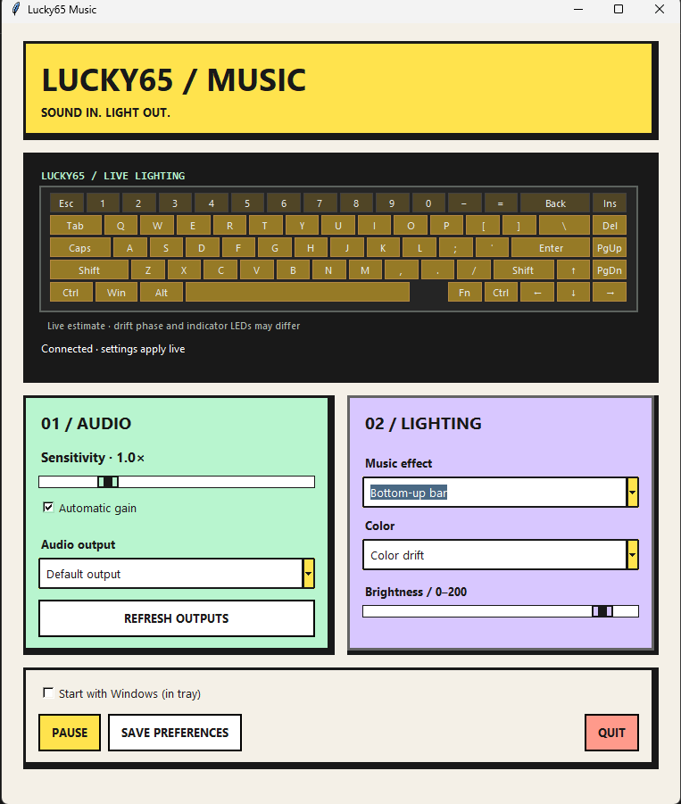
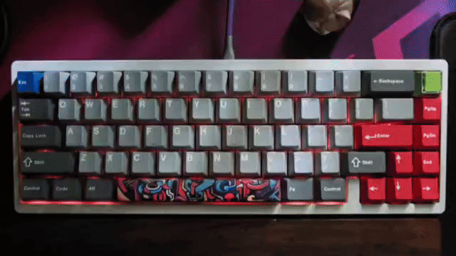

# Lucky65 Music

Audio-reactive lighting for the **Weikav Lucky65 V2**, with a standalone Windows app.



[](docs/images/vid.mp4)

## Features

- **Breathing** — all keys brighten and dim with your audio.
- **Bottom-up bar** — rows fill upward as the audio gets louder.
- Seven fixed colors and **color drift**.
- Live sensitivity, brightness, auto gain, pause, and audio-output controls.
- Minimalist keyboard lighting preview.
- System tray, saved preferences, and optional launch at Windows sign-in.
- Portable Windows EXE; no Python installation needed to run it. TUI also available.

## Quick start (Windows)

> **DO AT YOUR OWN RISK. I am not responsible for bricked keyboards or any damage caused by flashing or using this firmware.**

The modified firmware, desktop app, stock firmware, and Windows updater are
**included in this repo**. No build or Python installation is needed to use them.
See [Get the WB32 updater (Windows)](docs/technical-guide.md#get-the-wb32-updater-windows)
for the included tool's source and an alternative installation method.

1. Quit the music app and VIA. Set the keyboard to USB mode, then hold **Esc**
   while reconnecting it. From the repo root in PowerShell, check detection:

   ```powershell
   .\tools\wb32\wb32-dfu-updater_cli.exe --list
   ```

2. Flash only after your keyboard appears. If it says `Not found device!`, see
   [detection and driver help](docs/technical-guide.md#detect-before-flashing).
   Disconnect other DFU devices before flashing:

   ```powershell
   .\tools\wb32\wb32-dfu-updater_cli.exe -D .\build\firmware\modified\lucky65v2_via.bin
   ```

3. Reconnect normally in USB mode. Open `build\desktop\release\Lucky65Music.exe`,
   select **Breathing** or **Bottom-up bar**, and play audio.

Keep the updater EXE and its `libusb-1.0.dll` together in `tools/wb32/`.
Closing the window keeps the app in the tray. Use the tray menu to reopen or quit.
Enable **Start with Windows** to launch automatically at sign-in.

| Keyboard shortcut | Action |
|---|---|
| Fn + Right Ctrl + `\` | Switch between music effects |
| Fn + Enter | Cycle colors, including drift |

## Restore stock firmware

The repo **does include** [stock/lucky65v2_via_stock.bin](stock/lucky65v2_via_stock.bin).
Quit the app and VIA, hold **Esc** while reconnecting, and confirm detection with
`--list` as above. Then flash the included stock binary:

```powershell
.\tools\wb32\wb32-dfu-updater_cli.exe -D .\stock\lucky65v2_via_stock.bin
```

Reconnect normally. Stock firmware removes the custom music effects and app
lighting controls. The flashing disclaimer above applies.

## Build from source (optional)

Install [uv](https://docs.astral.sh/uv/getting-started/installation/) and
[Docker Desktop](https://www.docker.com/products/docker-desktop/) with its Linux
engine running. From the repo root in PowerShell:

```powershell
.\firmware\build-docker.ps1          # creates build/firmware/modified/lucky65v2_via.bin
.\musicviz-host\build-desktop.ps1    # creates build/desktop/release/Lucky65Music.exe
```

The ready-to-use firmware and EXE are tracked at these paths; rebuilding replaces
them locally. Other build intermediates remain Git-ignored. Python is bundled in the EXE; uv is needed only
for source workflows, and Docker only for firmware builds.

To run the TUI from source instead of building the EXE:

```powershell
cd musicviz-host
uv sync --locked
.\run-musicviz.cmd --tui
```

[Technical guide: setup, troubleshooting, recovery, builds, and protocol](docs/technical-guide.md)
